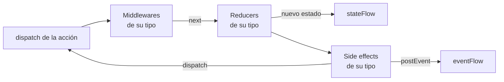

# Source

Una `EmaSource` guarda un estado que se gestiona con acciones, al estilo de Redux. Es el motor de
[`EmaViewModel`](viewmodel.es.md), y también se puede usar por sí sola.

Todas las acciones que entran en la source siguen el mismo camino, una acción detrás de otra:



1. Los **middlewares** deciden el camino de la acción: dejarla seguir, cambiarla, retrasarla o pararla.
2. Los **reducers** devuelven el siguiente estado. Se publica en cuanto lo devuelven.
3. Los **side effects** ejecutan la lógica de negocio de forma asíncrona, con el nuevo estado, y reaccionan despachando
   acciones o publicando eventos.

Cada pieza se declara para un tipo de acción y solo recibe las acciones de ese tipo, así que una jerarquía `sealed` de
acciones te permite gestionar una pantalla entera en un `when`, o una sola acción con su propia clase.

## Setup

La source se configura una vez, en `setup` (la función `setup` de un `EmaViewModel`, o el último parámetro de
`EmaSource(...)`). Después no se puede añadir nada.

```kotlin
override fun SourceSetupScope<CounterState, CounterAction, CounterEvent>.setup() {
    addMiddleware<CounterAction.Reset> { /* ... */ }
    addReducer<CounterAction> { action -> /* ... */ }
    addSideEffect<CounterAction.Increment> { /* ... */ }
}
```

Los middlewares se ejecutan en el orden en que se añaden, igual que los reducers: cada uno recibe el estado que ha
devuelto el anterior. Además de con lambdas, cada pieza se puede escribir como una clase (`EmaMiddleware`, `EmaReducer` y
`SideEffect`) o crear con `middlewareOf`, `middlewareDelayOf` y `reducerOf`, para reutilizarla o declararla como
propiedad.

Cada bloque solo alcanza lo que le pertenece: un reducer no puede añadir middlewares ni despachar, y un side effect no
puede añadir otros side effects. Las propiedades del ViewModel, como sus casos de uso, se pueden usar en todos.

## Reducers

Un reducer devuelve el siguiente estado para una acción. Solo lee `state`, así que es una función pura: no puede
despachar acciones, publicar eventos ni lanzar trabajo. Llamar a `dispatch` dentro de un reducer no compila.

```kotlin
addReducer<CounterAction> { action ->
    when (action) {
        CounterAction.Increment -> state.copy(count = state.count + 1)
        CounterAction.Reset -> state.copy(count = 0)
    }
}
```

## Middlewares

Un middleware recibe las acciones de su tipo antes de los reducers y decide su camino llamando a `next` **una vez**:

| En un middleware       | Efecto                                                                        |
|------------------------|-------------------------------------------------------------------------------|
| `next()`               | La acción sigue al siguiente middleware y a los reducers.                     |
| `next(action)`         | Sigue otra acción en lugar de la recibida.                                    |
| No llamar a `next`     | La acción se para aquí: no llega a los reducers ni a los side effects.        |
| `nextAfter { }`        | La acción sigue cuando termina el bloque. Mientras, la source sigue funcionando. |
| `dispatch(action)`     | Despacha una acción nueva.                                                    |
| `state`                | El estado actual.                                                             |

`nextAfter` espera sin bloquear la source. Dentro de su bloque, `stop()` lo termina sin que la acción siga.

```kotlin
addMiddleware<SearchAction.QueryWritten> { action ->
    // Debounce: una búsqueda nueva cancela la anterior, que no sigue
    nextAfter(id = "search", timeout = 5.seconds) {
        delay(300)
        if (action.query.isBlank()) stop()
    }
}
```

| Parámetro de `nextAfter` | Efecto                                                                      |
|--------------------------|-----------------------------------------------------------------------------|
| `id`                     | Se cancela un `nextAfter` con el mismo id que siga esperando.               |
| `timeout`                | Si el bloque no termina en ese tiempo, se cancela y se llama a `onTimeout`. |

`middlewareDelayOf(Tipo::class, delay)` crea un middleware que retrasa las acciones de un tipo. Los middlewares no
publican eventos: despachan una acción cuyo side effect lo publica. Para la lógica de negocio, usa un side effect.

## Side effects

Un side effect es la lógica de negocio que lanzan las acciones de su tipo: casos de uso, peticiones, temporizadores...
Se ejecuta de forma asíncrona después de los reducers de la acción, así que lee el nuevo estado.

```kotlin
addSideEffect<LoginAction.Login>(concurrency = SideEffectConcurrency.Leading, timeout = 30.seconds) {
    val user = loginUseCase(LoginUseCase.Input(state.userName, state.userPassword))
    dispatch(LoginRequest.Succeeded(user))
    postEvent(LoginEvent.LoginSuccess(user))
}
```

| En un side effect                | Efecto                                                                    |
|----------------------------------|---------------------------------------------------------------------------|
| `state`                          | El estado en el momento en que se lee.                                    |
| `dispatch(action)`               | Despacha una acción a la source.                                          |
| `postEvent(event)`               | Publica un [evento](events.es.md). Llega después de las acciones despachadas antes. |
| `broadcastDispatcher.dispatch()` | Emite una acción a otras sources. Consulta [Resultados entre pantallas](../guides/results-between-screens.es.md). |

`concurrency` decide qué pasa cuando una acción lanza el side effect mientras todavía se está ejecutando:

| `SideEffectConcurrency` | Comportamiento                                             | Ejemplo                       |
|-------------------------|------------------------------------------------------------|-------------------------------|
| `Every` (por defecto)   | Cada acción lo lanza, en paralelo.                         | Peticiones independientes.    |
| `Latest`                | Se cancela el que se está ejecutando y se lanza el nuevo.  | Una búsqueda mientras se escribe. |
| `Leading`               | Se ignora el nuevo mientras haya uno en ejecución.         | Un botón pulsado dos veces.   |

Con `timeout`, un side effect que no termina a tiempo se cancela y se llama a su `onTimeout`. Los errores siguen la
[configuración de los side effects](../guides/async-and-errors.es.md) de Emanate, como el `sideEffect` de los ViewModels
clásicos.

## Usar una source por sí sola

Una source no depende de ningún ViewModel. Créala con `EmaSource(...)`, observa `stateFlow` y `eventFlow`, y llama a
`close()` cuando ya no la necesites: procesa las acciones pendientes y cancela su trabajo.

```kotlin
val counter = EmaSource<CounterState, CounterAction, CounterEvent>(CounterState()) {
    addReducer<CounterAction.Increment> { state.copy(count = state.count + 1) }
}

counter.dispatch(CounterAction.Increment)
counter.close()
```

Por defecto se ejecuta en el dispatcher `main` de la [configuración](../guides/configuration.es.md); pasa otro en el
parámetro `dispatcher`.
