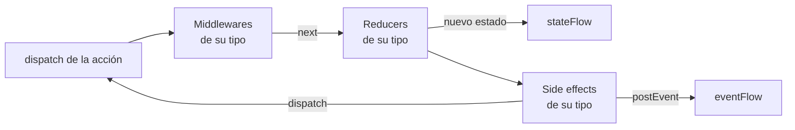

# Source

Una `EmaSource` guarda un estado que se gestiona con acciones, al estilo de Redux. Es el motor de
[`EmaViewModel`](viewmodel.es.md), y también se puede usar por sí sola.

Todas las acciones que entran en la source siguen el mismo camino, una acción detrás de otra:



1. Los **middlewares** deciden el camino de la acción: dejarla seguir, cambiarla, retrasarla o pararla.
2. Los **reducers** devuelven el siguiente estado. Se publica en cuanto lo devuelven.
3. Los **side effects** ejecutan la lógica de negocio de forma asíncrona, con el nuevo estado, y reaccionan despachando
   acciones o publicando eventos.

Cada pieza se declara para un tipo de acción y solo recibe las acciones de ese tipo, así que una jerarquía `sealed` de
acciones te permite gestionar una pantalla entera en un `when`, o una sola acción con su propia clase.

## Setup

La source se configura una vez, en `setup` (la función `setup` de un `EmaViewModel`, que devuelve `source { }`, o el
último parámetro de `EmaSource(...)`). Después no se puede añadir nada. Cada tipo de pieza tiene su propio bloque, en el
orden en que las recorre una acción:

```kotlin
override fun setup() = source {
    middlewares {
        add<CounterAction.Reset> { /* ... */ }
        +middlewareDelayOf(CounterAction.Increment::class, 300.milliseconds)
    }
    reducers {
        add<CounterAction> { action -> /* ... */ }
        // Declarado como propiedad del ViewModel
        +doubleReducer
    }
    sideEffects {
        add<CounterAction.Increment> { /* ... */ }
    }
    broadcasts {
        listen<SettingsBroadcast.CounterReset>()
    }
}
```

| Bloque            | Añade                                                                                |
|-------------------|--------------------------------------------------------------------------------------|
| `middlewares { }` | Los [middlewares](#middlewares), que se ejecutan primero.                            |
| `reducers { }`    | Los [reducers](#reducers).                                                           |
| `sideEffects { }` | Los [side effects](#side-effects).                                                   |
| `broadcasts { }`  | Los tipos de las acciones emitidas por otras sources que recibe, con `listen<Tipo>()`. Consulta [Resultados entre pantallas](../guides/results-between-screens.es.md). |

Dentro de un bloque, `add<Tipo> { }` añade una pieza para las acciones de ese tipo, y `+` añade una ya creada. Además
de con lambdas, cada pieza se puede escribir como una clase (`EmaMiddleware`, `EmaReducer` y `SideEffect`) o crear con
`middlewareOf`, `middlewareDelayOf` y `reducerOf`, para reutilizarla o declararla como propiedad.

Los middlewares se ejecutan en el orden en que se añaden, igual que los reducers: cada uno recibe el estado que ha
devuelto el anterior. Un bloque se puede usar más de una vez, por ejemplo para agrupar las piezas de cada
funcionalidad: sus piezas se añaden después de las de los bloques anteriores del mismo tipo.

Cada pieza solo alcanza lo que le pertenece: un reducer no puede añadir otras piezas ni despachar, y un side effect no
puede añadir otros side effects. Las propiedades del ViewModel, como sus casos de uso, se pueden usar en todos.

### Reutilizar piezas entre pantallas

Para compartir un grupo de piezas entre pantallas, escribe una función de extensión de `SourceSetupScope` con sus
bloques y llámala dentro de `source { }`. Como los bloques se pueden usar más de una vez, sus piezas se añaden en el
punto en que se llama, junto con las de la pantalla:

```kotlin
fun <S : EmaState, A : EmaAction, E : EmaEvent> SourceSetupScope<S, A, E>.analytics(tracker: Tracker, screen: String) {
    middlewares {
        add<EmaAction> { action ->
            tracker.track(action::class.simpleName.orEmpty())
            next()
        }
    }
    sideEffects {
        add<EmaAction.Lifecycle.Resumed> { tracker.screenShown(screen) }
    }
}

override fun setup() = source {
    analytics(tracker, screen = "Home")
    reducers {
        add<HomeAction> { action -> /* ... */ }
    }
}
```

Una función genérica como esta la puede usar cualquier pantalla. Sus side effects solo pueden despachar acciones de
tipo `A`, las de la pantalla que la llama, así que una función que despacha sus propias acciones se escribe para los
tipos de una pantalla: sirve para dividir un ViewModel grande por funcionalidades. La función solo alcanza lo que
recibe como parámetros, así que pásale los casos de uso que necesite.

## Reducers

Un reducer devuelve el siguiente estado para una acción. Solo lee `state`, así que es una función pura: no puede
despachar acciones, publicar eventos ni lanzar trabajo. Llamar a `dispatch` dentro de un reducer no compila.

```kotlin
reducers {
    add<CounterAction> { action ->
        when (action) {
            CounterAction.Increment -> state.copy(count = state.count + 1)
            CounterAction.Reset -> state.copy(count = 0)
        }
    }
}
```

## Middlewares

Un middleware recibe las acciones de su tipo antes de los reducers y decide su camino llamando a `next` **una vez**:

| En un middleware       | Efecto                                                                        |
|------------------------|-------------------------------------------------------------------------------|
| `next()`               | La acción sigue al siguiente middleware y a los reducers.                     |
| `next(action)`         | Sigue otra acción en lugar de la recibida.                                    |
| No llamar a `next`     | La acción se para aquí: no llega a los reducers ni a los side effects.        |
| `nextAfter { }`        | La acción sigue cuando termina el bloque. Mientras, la source sigue funcionando. |
| `dispatch(action)`     | Despacha una acción nueva.                                                    |
| `state`                | El estado actual.                                                             |

`nextAfter` espera sin bloquear la source. Dentro de su bloque, `stop()` lo termina sin que la acción siga.

```kotlin
middlewares {
    add<SearchAction.QueryWritten> { action ->
        // Debounce: una búsqueda nueva cancela la anterior, que no sigue
        nextAfter(id = "search", timeout = 5.seconds) {
            delay(300)
            if (action.query.isBlank()) stop()
        }
    }
}
```

| Parámetro de `nextAfter` | Efecto                                                                      |
|--------------------------|-----------------------------------------------------------------------------|
| `id`                     | Se cancela un `nextAfter` con el mismo id que siga esperando.               |
| `timeout`                | Si el bloque no termina en ese tiempo, se cancela y se llama a `onTimeout`. |

`middlewareDelayOf(Tipo::class, delay)` crea un middleware que retrasa las acciones de un tipo. Los middlewares no
publican eventos: despachan una acción cuyo side effect lo publica. Para la lógica de negocio, usa un side effect.

## Side effects

Un side effect es la lógica de negocio que lanzan las acciones de su tipo: casos de uso, peticiones, temporizadores...
Se ejecuta de forma asíncrona después de los reducers de la acción, así que lee el nuevo estado.

```kotlin
sideEffects {
    add<LoginAction.Login>(concurrency = SideEffectConcurrency.Leading, timeout = 30.seconds) {
        val user = loginUseCase(LoginUseCase.Input(state.userName, state.userPassword))
        dispatch(LoginRequest.Succeeded(user))
        postEvent(LoginEvent.LoginSuccess(user))
    }
}
```

| En un side effect                | Efecto                                                                    |
|----------------------------------|---------------------------------------------------------------------------|
| `state`                          | El estado en el momento en que se lee.                                    |
| `dispatch(action)`               | Despacha una acción a la source.                                          |
| `postEvent(event)`               | Publica un [evento](events.es.md). Llega después de las acciones despachadas antes. |
| `broadcast(action)`              | Emite una acción a otras sources. Consulta [Resultados entre pantallas](../guides/results-between-screens.es.md). |

`concurrency` decide qué pasa cuando una acción lanza el side effect mientras todavía se está ejecutando:

| `SideEffectConcurrency` | Comportamiento                                             | Ejemplo                       |
|-------------------------|------------------------------------------------------------|-------------------------------|
| `Every` (por defecto)   | Cada acción lo lanza, en paralelo.                         | Peticiones independientes.    |
| `Latest`                | Se cancela el que se está ejecutando y se lanza el nuevo.  | Una búsqueda mientras se escribe. |
| `Leading`               | Se ignora el nuevo mientras haya uno en ejecución.         | Un botón pulsado dos veces.   |

Con `timeout`, un side effect que no termina a tiempo se cancela y se llama a su `onTimeout`. Los errores siguen la
[configuración de los side effects](../guides/async-and-errors.es.md) de Emanate, como el `sideEffect` de los ViewModels
clásicos.

## Usar una source por sí sola

Una source no depende de ningún ViewModel. Créala con `EmaSource(...)`, observa `stateFlow` y `eventFlow`, y llama a
`close()` cuando ya no la necesites: procesa las acciones pendientes y cancela su trabajo.

```kotlin
val counter = EmaSource<CounterState, CounterAction, CounterEvent>(CounterState()) {
    reducers {
        add<CounterAction.Increment> { state.copy(count = state.count + 1) }
    }
}

counter.dispatch(CounterAction.Increment)
counter.close()
```

Por defecto usa la [configuración](../guides/configuration.es.md) de Emanate y se ejecuta en su dispatcher `main`; pasa
otra en los parámetros `configuration` o `dispatcher`.
