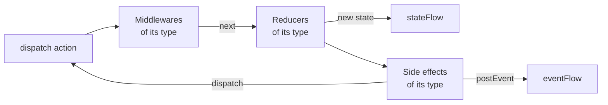

# Source

An `EmaSource` holds a state handled with actions, in the style of Redux. It is the engine of
[`EmaViewModel`](viewmodel.md), and it can also be used on its own.

Every action that enters the source goes through the same path, one action after another:



1. The **middlewares** decide the path of the action: let it continue, change it, delay it or stop it.
2. The **reducers** return the next state. It is published as soon as they return.
3. The **side effects** run the business logic asynchronously, with the new state, and react dispatching actions or
   posting events.

Each piece is declared for a type of action and only receives the actions of that type, so a `sealed` hierarchy of
actions lets you handle a whole screen in one `when`, or a single action with its own class.

## Setup

The source is configured once, in `setup` (the `setup` function of an `EmaViewModel`, which returns `source { }`, or
the last parameter of `EmaSource(...)`). Nothing can be added after it. Each kind of piece has its own block, in the
order an action goes through them:

```kotlin
override fun setup() = source {
    middlewares {
        add<CounterAction.Reset> { /* ... */ }
        +middlewareDelayOf(CounterAction.Increment::class, 300.milliseconds)
    }
    reducers {
        add<CounterAction> { action -> /* ... */ }
        // Declared as a property of the ViewModel
        +doubleReducer
    }
    sideEffects {
        add<CounterAction.Increment> { /* ... */ }
    }
    broadcasts {
        listen<SettingsBroadcast.CounterReset>()
    }
}
```

| Block             | Adds                                                                                  |
|-------------------|---------------------------------------------------------------------------------------|
| `middlewares { }` | The [middlewares](#middlewares), which run first.                                    |
| `reducers { }`    | The [reducers](#reducers).                                                           |
| `sideEffects { }` | The [side effects](#side-effects).                                                   |
| `broadcasts { }`  | The types of the actions broadcast by other sources that it receives, with `listen<Type>()`. See [Results between screens](../guides/results-between-screens.md). |

Inside a block, `add<Type> { }` adds a piece for the actions of that type, and `+` adds one already created. Besides
the lambdas, each piece can be written as a class (`EmaMiddleware`, `EmaReducer` and `SideEffect`) or created with
`middlewareOf`, `middlewareDelayOf` and `reducerOf`, to reuse it or declare it as a property.

The middlewares run in the order they are added, and so do the reducers: each one receives the state returned by the
previous one. A block can be used more than once, for example to group the pieces of each feature: its pieces are
added after the ones of the previous blocks of the same kind.

Each piece only reaches what belongs to it: a reducer can't add other pieces nor dispatch, and a side effect can't
add other side effects. The properties of the ViewModel, like its use cases, can be used everywhere.

### Reusing pieces between screens

To share a group of pieces between screens, write an extension function of `SourceSetupScope` with its blocks and
call it inside `source { }`. As the blocks can be used more than once, its pieces are added in the place where it is
called, together with the ones of the screen:

```kotlin
fun <S : EmaState, A : EmaAction, E : EmaEvent> SourceSetupScope<S, A, E>.analytics(tracker: Tracker, screen: String) {
    middlewares {
        add<EmaAction> { action ->
            tracker.track(action::class.simpleName.orEmpty())
            next()
        }
    }
    sideEffects {
        add<EmaAction.Lifecycle.Resumed> { tracker.screenShown(screen) }
    }
}

override fun setup() = source {
    analytics(tracker, screen = "Home")
    reducers {
        add<HomeAction> { action -> /* ... */ }
    }
}
```

A generic function like this one can be used by any screen. Its side effects can only dispatch actions of type `A`,
the actions of the screen that calls it, so a function that dispatches its own actions is written for the types of
one screen: it is useful to split a big ViewModel by feature. The function only reaches what it receives as
parameters, so pass it the use cases it needs.

## Reducers

A reducer returns the next state for an action. It only reads `state`, so it is a pure function: it can't dispatch
actions, post events nor launch work. Calling `dispatch` inside a reducer doesn't compile.

```kotlin
reducers {
    add<CounterAction> { action ->
        when (action) {
            CounterAction.Increment -> state.copy(count = state.count + 1)
            CounterAction.Reset -> state.copy(count = 0)
        }
    }
}
```

## Middlewares

A middleware receives the actions of its type before the reducers and decides their path calling `next` **once**:

| In a middleware        | Effect                                                                        |
|------------------------|-------------------------------------------------------------------------------|
| `next()`               | The action continues to the next middleware and to the reducers.              |
| `next(action)`         | Other action continues instead of the received one.                           |
| Not calling `next`     | The action stops here: it doesn't reach the reducers nor the side effects.    |
| `nextAfter { }`        | The action continues when the block finishes. The source keeps working meanwhile. |
| `dispatch(action)`     | Dispatches a new action.                                                      |
| `state`                | The current state.                                                            |

`nextAfter` waits without blocking the source. Inside its block, `stop()` finishes it without continuing the action.

```kotlin
middlewares {
    add<SearchAction.QueryWritten> { action ->
        // Debounce: a new query cancels the previous one, which doesn't continue
        nextAfter(id = "search", timeout = 5.seconds) {
            delay(300)
            if (action.query.isBlank()) stop()
        }
    }
}
```

| `nextAfter` parameter | Effect                                                                         |
|-----------------------|--------------------------------------------------------------------------------|
| `id`                  | A `nextAfter` with the same id that is still waiting is cancelled.            |
| `timeout`             | If the block doesn't finish in this time, it is cancelled and `onTimeout` is called. |

`middlewareDelayOf(Type::class, delay)` creates a middleware that delays the actions of a type. Middlewares don't
post events: they dispatch an action whose side effect posts it. For business logic, use a side effect.

## Side effects

A side effect is the business logic launched by the actions of its type: use cases, requests, timers... It runs
asynchronously after the reducers of the action, so it reads the new state.

```kotlin
sideEffects {
    add<LoginAction.Login>(concurrency = SideEffectConcurrency.Leading, timeout = 30.seconds) {
        val user = loginUseCase(LoginUseCase.Input(state.userName, state.userPassword))
        dispatch(LoginRequest.Succeeded(user))
        postEvent(LoginEvent.LoginSuccess(user))
    }
}
```

| In a side effect                 | Effect                                                                    |
|----------------------------------|---------------------------------------------------------------------------|
| `state`                          | The state at the moment it is read.                                       |
| `dispatch(action)`               | Dispatches an action to the source.                                       |
| `postEvent(event)`               | Posts an [event](events.md). It arrives after the actions dispatched before it. |
| `broadcast(action)`              | Broadcasts an action to other sources. See [Results between screens](../guides/results-between-screens.md). |

`concurrency` decides what happens when an action launches the side effect while it is still running:

| `SideEffectConcurrency` | Behaviour                                                  | Example                      |
|-------------------------|------------------------------------------------------------|------------------------------|
| `Every` (default)       | Every action launches it, in parallel.                     | Independent requests.        |
| `Latest`                | The running one is cancelled and the new one is launched.  | A search while typing.       |
| `Leading`               | The new one is ignored while one is running.               | A button tapped twice.       |

With `timeout`, a side effect that doesn't finish in time is cancelled and its `onTimeout` is called. The errors
follow the [side effect configuration](../guides/async-and-errors.md) of Emanate, like the `sideEffect` of the
classic ViewModels.

## Using a source on its own

A source doesn't depend on any ViewModel. Create it with `EmaSource(...)`, observe `stateFlow` and `eventFlow`, and
call `close()` when it isn't needed anymore: it processes the pending actions and cancels its work.

```kotlin
val counter = EmaSource<CounterState, CounterAction, CounterEvent>(CounterState()) {
    reducers {
        add<CounterAction.Increment> { state.copy(count = state.count + 1) }
    }
}

counter.dispatch(CounterAction.Increment)
counter.close()
```

By default it uses the [configuration](../guides/configuration.md) of Emanate and runs on its `main` dispatcher; pass
another one in the `configuration` or `dispatcher` parameters.
