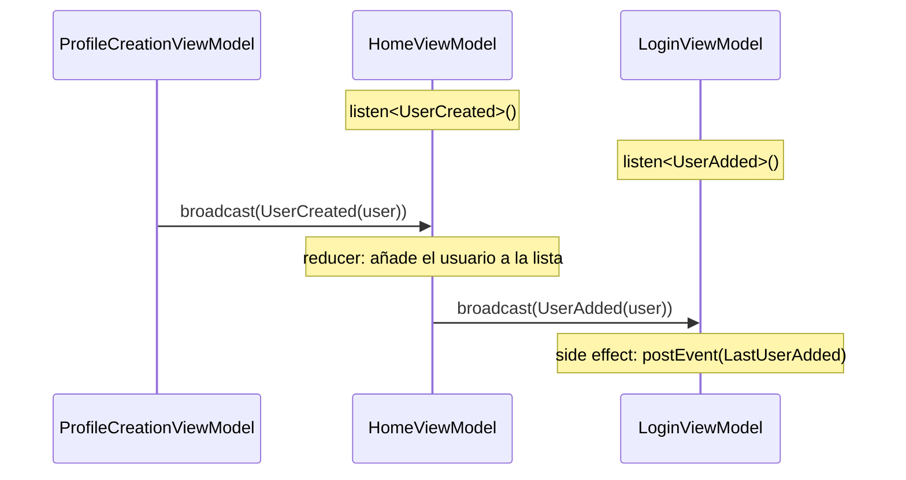

# Resultados entre pantallas

A veces una pantalla tiene que decirle algo a la anterior: "he creado este usuario". El resultado se emite como una
acción con cualquier [ViewModel](../concepts/viewmodel.es.md): `EmaViewModel` y los clásicos comparten el mismo
broadcaster, así que un ViewModel clásico puede recibir lo que emite un `EmaViewModel`, y al revés.

## Con EmaViewModel: acciones emitidas

Un resultado es una **acción**, y su tipo es el id del broadcast. El emisor la emite desde un side effect, y todos los
ViewModels que escuchan ese tipo la reciben como una acción más de su source: pasa por sus middlewares, reducers y side
effects de ese tipo.



Declara el resultado como una acción, junto a las acciones de la pantalla que lo envía:

```kotlin
sealed interface ProfileCreationBroadcast : EmaAction {
    data class UserCreated(val user: User) : ProfileCreationBroadcast
}
```

### Enviar

Emítelo con `broadcast`, disponible en todos los side effects. Acepta cualquier acción:

```kotlin
sideEffects {
    add<ProfileCreationAction.DialogConfirmClicked> {
        val user = User(state.name, state.surname, state.role)
        broadcast(ProfileCreationBroadcast.UserCreated(user), keepUntilReceived = true)
        postEvent(ProfileCreationEvent.DialogConfirmationAccepted)
    }
}
```

### Recibir

Escucha su tipo en el bloque `broadcasts` de `setup` y gestiónalo como cualquier otra acción:

```kotlin
override fun setup() = source {
    reducers {
        add<ProfileCreationBroadcast.UserCreated> { action ->
            state.copy(userList = state.userList + action.user)
        }
    }
    sideEffects {
        // Lo pasa a la pantalla de login
        add<ProfileCreationBroadcast.UserCreated> { action ->
            broadcast(HomeBroadcast.UserAdded(action.user), keepUntilReceived = true)
        }
    }
    broadcasts {
        listen<ProfileCreationBroadcast.UserCreated>()
    }
}
```

### Reglas

- **La entrega es inmediata**, a todos los ViewModels que escuchan el tipo en ese momento. Los ViewModels de las
  pantallas anteriores siguen vivos en el back stack, así que lo reciben. Si nadie escucha, la acción se pierde, salvo
  que se guarde.
- **Cualquier número de receptores.** Todos los ViewModels que escuchan el tipo reciben la acción.
- **El listener se elimina cuando se destruye el ViewModel**, junto con el resto de su trabajo.
- **Tiene tipo.** El resultado es una data class, sin casts.
- **Vive en memoria.** No se guarda si se mata el proceso.

### Guardarla hasta que se reciba

Con `keepUntilReceived = true`, una acción que nadie escucha se guarda y se entrega al **primer** ViewModel que escuche
su tipo. Solo se guarda la última de cada clase. Si alguien escucha, se entrega en el momento, como siempre.

Cubre la pantalla que todavía no se ha creado: después de que se mate el proceso, Android restaura la pantalla actual,
pero el ViewModel de la anterior solo se crea cuando el usuario vuelve a ella. Sin guardar el resultado, se perdería. No
cubre un proceso que muere después de emitir el resultado: también se guarda en memoria.

En los tests, `resetTestDispatchers` de `emanate-test` elimina las acciones guardadas que nadie ha recibido.

> Si el receptor muestra algo, publica un evento: espera hasta que la vista lo consume, así que se muestra cuando la
> pantalla vuelve a estar visible.

## Con los ViewModels clásicos

Los ViewModels clásicos emiten y reciben las mismas acciones, con dos funciones.

### Enviar

Llama a `broadcast` con la acción:

```kotlin
private fun onActionDialogConfirmClicked() {
    hideOverlap()
    val user = User(state.name, state.surname, state.role)
    broadcast(ProfileCreationBroadcast.UserCreated(user), keepUntilReceived = true)
    postEvent(ProfileCreationEvent.DialogConfirmationAccepted)
}
```

### Recibir

Registra un listener de su tipo en `onBroadcastListenerSetup`. Se elimina cuando se destruye el ViewModel:

```kotlin
override fun onBroadcastListenerSetup() {
    registerBroadcastListener<ProfileCreationBroadcast.UserCreated> { action ->
        updateState { copy(userList = userList + action.user) }
        // Lo pasa a la pantalla de login
        broadcast(HomeBroadcast.UserAdded(action.user), keepUntilReceived = true)
    }
}
```

Las reglas son las [mismas](#reglas). El listener se ejecuta en el scope del ViewModel.

> Si el receptor reacciona mostrando algo, guarda el resultado y publica un evento desde `onViewResumed`, como hace
> `LoginActionViewModel`, en vez de actuar desde el listener: puede que la vista todavía no esté lista.
