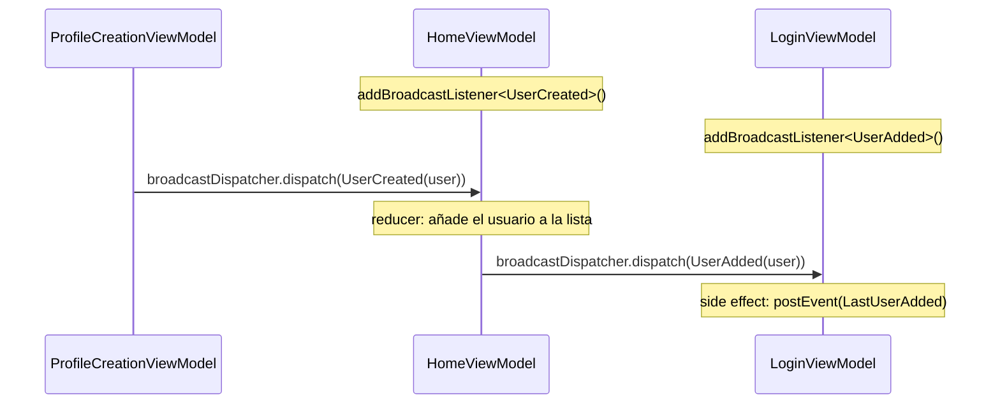
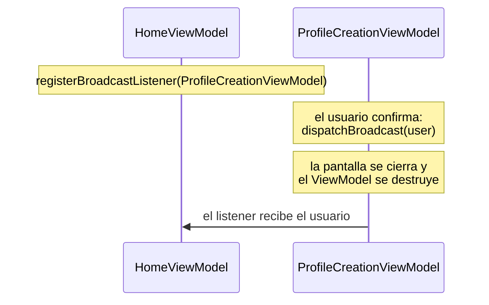

# Resultados entre pantallas

A veces una pantalla tiene que decirle algo a la anterior: "he creado este usuario". Cómo se envía el resultado depende
del [ViewModel](../concepts/viewmodel.es.md): un `EmaViewModel` emite una acción, y un ViewModel clásico envía un back
broadcast.

## Con EmaViewModel: acciones emitidas

Un resultado es una **acción**, y su tipo es el id del broadcast. El emisor la emite desde un side effect, y todos los
ViewModels que escuchan ese tipo la reciben como una acción más de su source: pasa por sus middlewares, reducers y side
effects de ese tipo.



Declara el resultado como una acción, junto a las acciones de la pantalla que lo envía:

```kotlin
sealed interface ProfileCreationBroadcast : EmaAction {
    data class UserCreated(val user: User) : ProfileCreationBroadcast
}
```

### Enviar

Emítelo con `broadcastDispatcher`, disponible en todos los side effects. Acepta cualquier acción:

```kotlin
addSideEffect<ProfileCreationAction.DialogConfirmClicked> {
    broadcastDispatcher.dispatch(ProfileCreationBroadcast.UserCreated(User(state.name, state.surname, state.role)))
    postEvent(ProfileCreationEvent.DialogConfirmationAccepted)
}
```

### Recibir

Escucha su tipo en `setup` y gestiónalo como cualquier otra acción:

```kotlin
override fun SourceSetupScope<HomeState, HomeAction, HomeEvent>.setup() {
    addBroadcastListener<ProfileCreationBroadcast.UserCreated>()

    addReducer<ProfileCreationBroadcast.UserCreated> { action ->
        state.copy(userList = state.userList + action.user)
    }
    // Lo pasa a la pantalla de login
    addSideEffect<ProfileCreationBroadcast.UserCreated> { action ->
        broadcastDispatcher.dispatch(HomeBroadcast.UserAdded(action.user))
    }
}
```

### Reglas

- **La entrega es inmediata**, a todos los ViewModels que escuchan el tipo en ese momento. Los ViewModels de las
  pantallas anteriores siguen vivos en el back stack, así que lo reciben. Si nadie escucha, la acción se pierde.
- **Cualquier número de receptores.** Todas las sources que escuchan el tipo reciben la acción.
- **El listener se elimina cuando se destruye el ViewModel**, junto con el resto de su trabajo.
- **Tiene tipo.** El resultado es una data class, sin casts.
- **Vive en memoria.** No se guarda si se mata el proceso.

> Si el receptor muestra algo, publica un evento: espera hasta que la vista lo consume, así que se muestra cuando la
> pantalla vuelve a estar visible.

## Con los ViewModels clásicos: back broadcast

Un back broadcast es un mensaje punto a punto, del ViewModel de una pantalla al ViewModel de otra, que se entrega cuando
se cierra la primera.



### Enviar

En la pantalla que se cierra, llama a `dispatchBroadcast` con los datos:

```kotlin
private fun onActionDialogConfirmClicked() {
    hideOverlap()
    dispatchBroadcast(User(state.name, state.surname, state.role))
    postEvent(ProfileCreationEvent.DialogConfirmationAccepted)
}
```

### Recibir

En la pantalla que espera, registra un listener en `onBroadcastListenerSetup`. El id del emisor es la clase de su ViewModel:

```kotlin
override fun onBroadcastListenerSetup() {
    registerBroadcastListener(ProfileCreationViewModel::class.backBroadcastId) {
        val user = it as User
        updateState { copy(userList = userList + user) }
    }
}
```

### Pasarlo a lo largo de una cadena

El resultado del emisor se entrega a **un** receptor. Para reenviarlo más allá, vuelve a enviarlo desde el receptor.
En el sample, `HomeActionViewModel` recibe el usuario nuevo de la pantalla de creación, lo añade a su lista y llama a
`dispatchBroadcast(user)` para que `LoginActionViewModel` lo reciba cuando se cierre Home.

### Reglas

- **La entrega ocurre cuando se destruye el ViewModel del emisor**, es decir, cuando se cierra su pantalla.
- **Solo un receptor por emisor.** Registrar un segundo listener para el mismo emisor lanza `IllegalStateException`.
- **El resultado se guarda si todavía no hay nadie escuchando**, y se entrega cuando el receptor se registra. Esto cubre
  el caso en que la pantalla anterior se recrea después de la muerte del proceso.
- **Vive en memoria.** No se guarda si el proceso muere. Los datos son de tipo `Any?`, así que haz el cast con cuidado.

> Si el receptor reacciona mostrando algo, guarda el resultado y publica un evento desde `onViewResumed`, como hace
> `LoginActionViewModel`, en vez de actuar desde el listener: puede que la vista todavía no esté lista.

## Broadcasts globales

Para eventos que no dependen del cierre de una pantalla, usa el `Ema.broadcastManager` global de la app. Pásalo a las
clases que lo necesiten como un `EmaBroadcastManager`, para que en los tests puedan recibir uno falso.

```kotlin
class UserCreated(override val data: User) : EmaBroadcastEvent<User>

// Receptor (se suspende mientras escucha, así que lánzalo en una corrutina)
sideEffect {
    broadcastManager.registerBroadcast(UserCreated::class) { user -> /* ... */ }
}

// Emisor
broadcastManager.sendBroadcastEvent(UserCreated(user))
```

Los listeners tienen que registrarse antes de enviar el evento: los eventos no se repiten.
