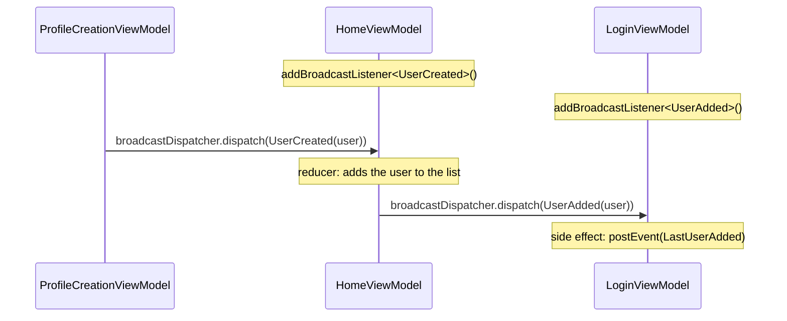
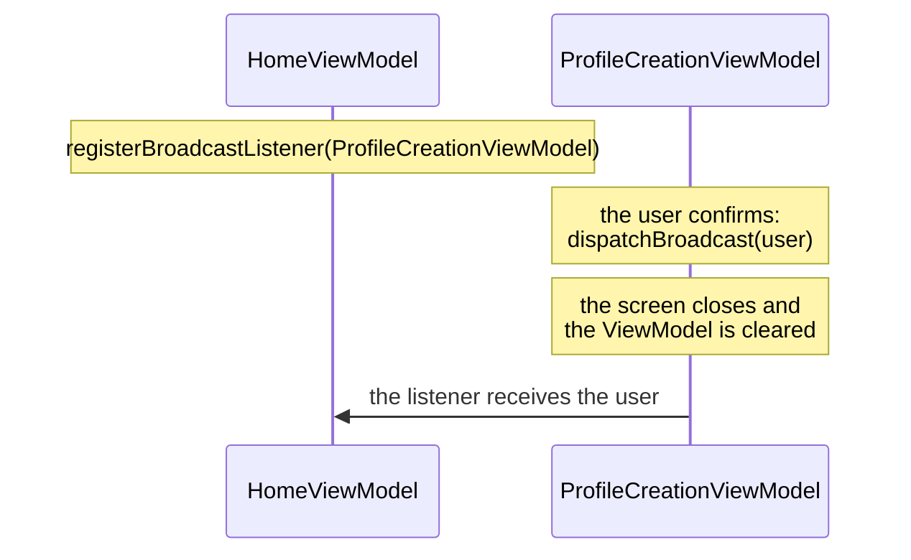

# Results between screens

Sometimes a screen needs to tell the previous one something: "I created this user". How the result is sent depends on
the [ViewModel](../concepts/viewmodel.md): an `EmaViewModel` broadcasts an action, and a classic ViewModel sends a back
broadcast.

## With EmaViewModel: broadcast actions

A result is an **action**, and its type is the id of the broadcast. The sender broadcasts it from a side effect, and
every ViewModel listening to that type receives it as one more action of its source: it goes through its middlewares,
reducers and side effects of that type.



Declare the result as an action, next to the actions of the screen that sends it:

```kotlin
sealed interface ProfileCreationBroadcast : EmaAction {
    data class UserCreated(val user: User) : ProfileCreationBroadcast
}
```

### Send

Broadcast it with `broadcastDispatcher`, available in every side effect. It accepts any action:

```kotlin
addSideEffect<ProfileCreationAction.DialogConfirmClicked> {
    broadcastDispatcher.dispatch(ProfileCreationBroadcast.UserCreated(User(state.name, state.surname, state.role)))
    postEvent(ProfileCreationEvent.DialogConfirmationAccepted)
}
```

### Receive

Listen to its type in `setup` and handle it like any other action:

```kotlin
override fun SourceSetupScope<HomeState, HomeAction, HomeEvent>.setup() {
    addBroadcastListener<ProfileCreationBroadcast.UserCreated>()

    addReducer<ProfileCreationBroadcast.UserCreated> { action ->
        state.copy(userList = state.userList + action.user)
    }
    // Passes it along to the login screen
    addSideEffect<ProfileCreationBroadcast.UserCreated> { action ->
        broadcastDispatcher.dispatch(HomeBroadcast.UserAdded(action.user))
    }
}
```

### Rules

- **Delivery is immediate**, to every ViewModel listening to the type at that moment. The ViewModels of the previous
  screens are alive in the back stack, so they receive it. If nobody is listening, the action is lost.
- **Any number of receivers.** Every source that listens to the type receives the action.
- **The listener is removed when the ViewModel is cleared**, together with the rest of its work.
- **It is typed.** The result is a data class, with no casts.
- **It lives in memory.** It is not saved if the process is killed.

> If the receiver shows something, post an event: it waits until the view consumes it, so it is shown when the
> screen is visible again.

## With the classic ViewModels: back broadcast

A back broadcast is a point-to-point message, from the ViewModel of one screen to the ViewModel of another, delivered
when the first one is closed.



### Send

In the screen that closes, call `dispatchBroadcast` with the data:

```kotlin
private fun onActionDialogConfirmClicked() {
    hideOverlap()
    dispatchBroadcast(User(state.name, state.surname, state.role))
    postEvent(ProfileCreationEvent.DialogConfirmationAccepted)
}
```

### Receive

In the screen that is waiting, register a listener in `onBroadcastListenerSetup`. The id of the sender is its ViewModel class:

```kotlin
override fun onBroadcastListenerSetup() {
    registerBroadcastListener(ProfileCreationViewModel::class.backBroadcastId) {
        val user = it as User
        updateState { copy(userList = userList + user) }
    }
}
```

### Passing it along a chain

The result of the sender is delivered to **one** receiver. To forward it further, dispatch it again from the receiver.
In the sample, `HomeActionViewModel` receives the new user from the creation screen, adds it to its list and
calls `dispatchBroadcast(user)` so that `LoginActionViewModel` receives it when Home is closed.

### Rules

- **Delivery happens when the sender's ViewModel is cleared**, that is, when its screen is closed.
- **Only one receiver per sender.** Registering a second listener for the same sender throws `IllegalStateException`.
- **The result is kept if nobody is listening yet**, and delivered when the receiver registers. This covers the case
  where the previous screen is recreated after process death.
- **It lives in memory.** It is not saved if the process is killed. The data is typed `Any?`, so cast it carefully.

> If the receiver reacts by showing something, store the result and post an event from `onViewResumed`, as
> `LoginActionViewModel` does, instead of acting from the listener: the view may not be ready yet.

## App-wide broadcasts

For events that are not tied to a screen closing, use the app-wide `Ema.broadcastManager`. Pass it to the classes that
need it as an `EmaBroadcastManager`, so they can receive a fake in tests.

```kotlin
class UserCreated(override val data: User) : EmaBroadcastEvent<User>

// Receiver (suspends while it listens, so launch it in a coroutine)
sideEffect {
    broadcastManager.registerBroadcast(UserCreated::class) { user -> /* ... */ }
}

// Sender
broadcastManager.sendBroadcastEvent(UserCreated(user))
```

Listeners must be registered before the event is sent: events are not replayed.
