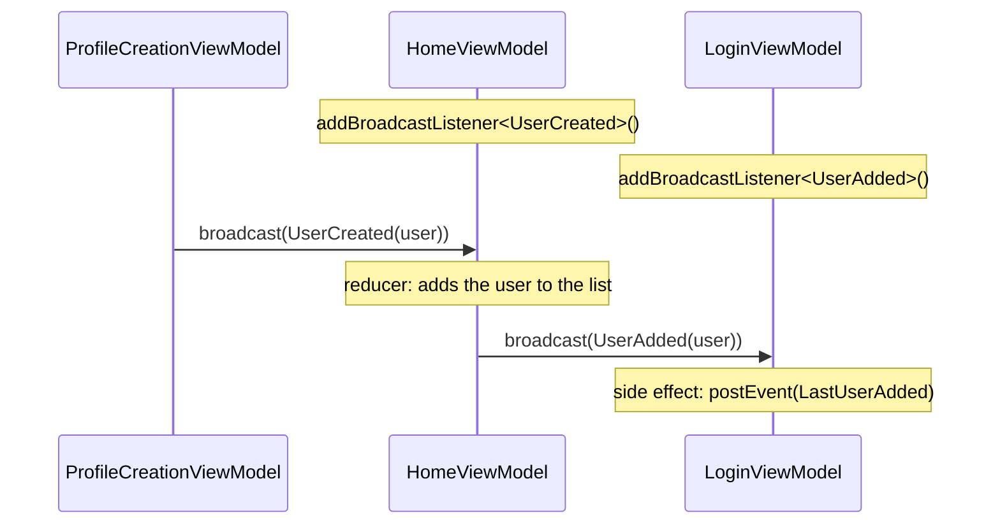

# Results between screens

Sometimes a screen needs to tell the previous one something: "I created this user". The result is broadcast as an
action, with every [ViewModel](../concepts/viewmodel.md): `EmaViewModel` and the classic ones share the same broadcaster,
so a classic ViewModel can receive what an `EmaViewModel` broadcasts, and the other way round.

## With EmaViewModel: broadcast actions

A result is an **action**, and its type is the id of the broadcast. The sender broadcasts it from a side effect, and
every ViewModel listening to that type receives it as one more action of its source: it goes through its middlewares,
reducers and side effects of that type.



Declare the result as an action, next to the actions of the screen that sends it:

```kotlin
sealed interface ProfileCreationBroadcast : EmaAction {
    data class UserCreated(val user: User) : ProfileCreationBroadcast
}
```

### Send

Broadcast it with `broadcast`, available in every side effect. It accepts any action:

```kotlin
addSideEffect<ProfileCreationAction.DialogConfirmClicked> {
    broadcast(ProfileCreationBroadcast.UserCreated(User(state.name, state.surname, state.role)), keepUntilReceived = true)
    postEvent(ProfileCreationEvent.DialogConfirmationAccepted)
}
```

### Receive

Listen to its type in `setup` and handle it like any other action:

```kotlin
override fun SourceSetupScope<HomeState, HomeAction, HomeEvent>.setup() {
    addBroadcastListener<ProfileCreationBroadcast.UserCreated>()

    addReducer<ProfileCreationBroadcast.UserCreated> { action ->
        state.copy(userList = state.userList + action.user)
    }
    // Passes it along to the login screen
    addSideEffect<ProfileCreationBroadcast.UserCreated> { action ->
        broadcast(HomeBroadcast.UserAdded(action.user), keepUntilReceived = true)
    }
}
```

### Rules

- **Delivery is immediate**, to every ViewModel listening to the type at that moment. The ViewModels of the previous
  screens are alive in the back stack, so they receive it. If nobody is listening, the action is lost, unless it is
  kept.
- **Any number of receivers.** Every ViewModel that listens to the type receives the action.
- **The listener is removed when the ViewModel is cleared**, together with the rest of its work.
- **It is typed.** The result is a data class, with no casts.
- **It lives in memory.** It is not saved if the process is killed.

### Keep it until it is received

With `keepUntilReceived = true`, an action that nobody is listening to is kept and delivered to the **first** ViewModel
that listens to its type. Only the last one of each class is kept. If someone is listening, it is delivered at the
moment, as always.

It covers the screen that is not created yet: after the process is killed, Android restores the current screen, but
the ViewModel of the previous one is created only when the user goes back to it. Without keeping the result, it would
be lost. It doesn't cover a process killed after the result is broadcast: it is kept in memory too.

In tests, `resetTestDispatchers` of `emanate-test` removes the kept actions that nobody received.

> If the receiver shows something, post an event: it waits until the view consumes it, so it is shown when the
> screen is visible again.

## With the classic ViewModels

The classic ViewModels broadcast and receive the same actions, with two functions.

### Send

Call `broadcast` with the action:

```kotlin
private fun onActionDialogConfirmClicked() {
    hideOverlap()
    val user = User(state.name, state.surname, state.role)
    broadcast(ProfileCreationBroadcast.UserCreated(user), keepUntilReceived = true)
    postEvent(ProfileCreationEvent.DialogConfirmationAccepted)
}
```

### Receive

Register a listener of its type in `onBroadcastListenerSetup`. It is removed when the ViewModel is cleared:

```kotlin
override fun onBroadcastListenerSetup() {
    registerBroadcastListener<ProfileCreationBroadcast.UserCreated> { action ->
        updateState { copy(userList = userList + action.user) }
        // Passes it along to the login screen
        broadcast(HomeBroadcast.UserAdded(action.user), keepUntilReceived = true)
    }
}
```

The rules are the [same](#rules). The listener runs in the scope of the ViewModel.

> If the receiver reacts by showing something, store the result and post an event from `onViewResumed`, as
> `LoginActionViewModel` does, instead of acting from the listener: the view may not be ready yet.
